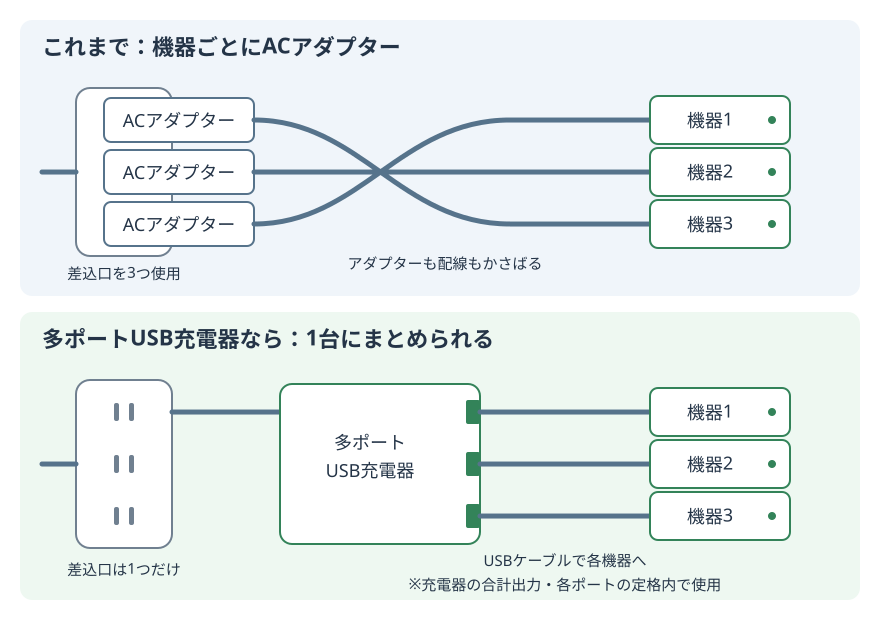
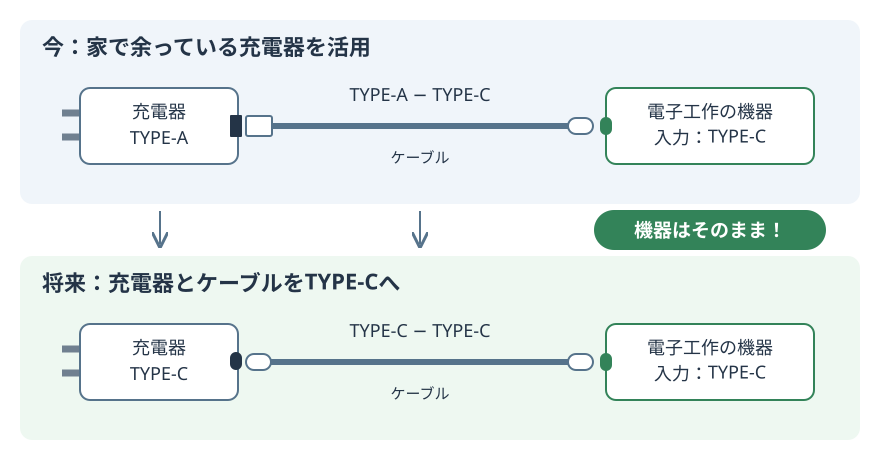
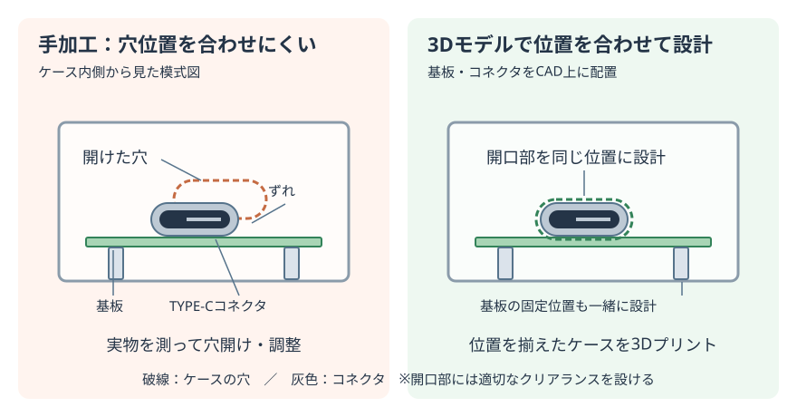
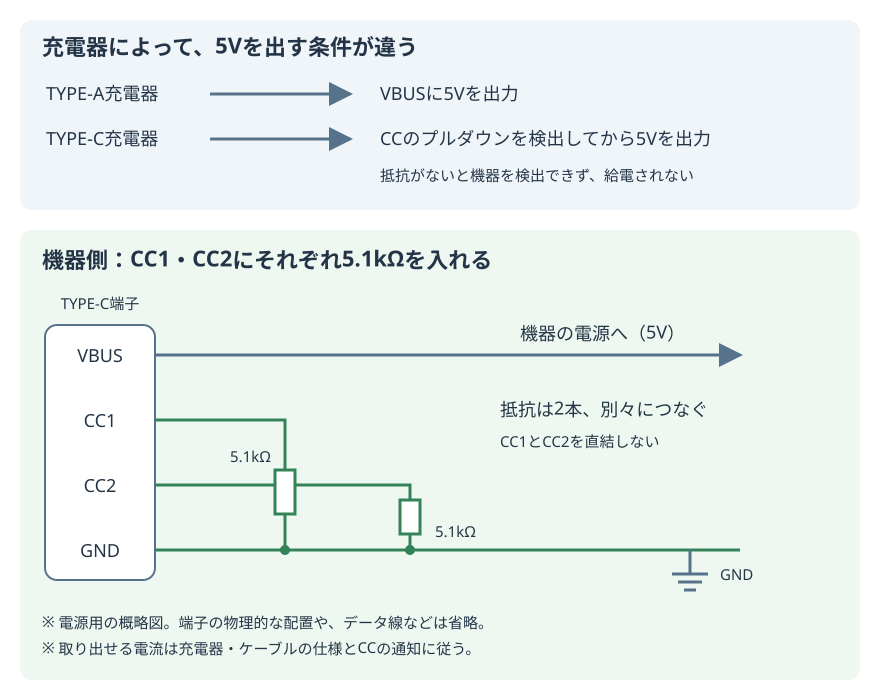

+++
date ="2026-11-02"
title = "そろそろ電子工作機器の電源をACアダプターからUSBに乗り換える時かもしれない"
[taxonomies]
tags = ["DIY"]
[extra]
og_image = "https://akizukidenshi.com/img/goods/L/106096.jpg"
+++

# ACアダプターの価格が上がっている

<a href="https://akizukidenshi.com/catalog/g/g106096/"><br>秋月の5V 1Aクラス</a>が800円になっている。記憶が正しければ、5V 1Aクラスなら昔は350円くらいだったように思う。秋月だけが高いわけではない。検索してみると、どこもだいたいこのくらいの価格になっている。

最初は円安、インフレのせいなのだなと思ったのだが、2倍はちょっと上がり過ぎであろう。調べてみると気付いたのが、

<a href="https://www.amazon.co.jp/dp/B0D97Y1WVQ"><br>USB出力のもの</a>なら500円台で売られていることが分かった。

つまりどうやらDCジャック出力のACアダプターは完全なニッチ製品になってしまったのだろう。確かにこの手の小型機器の電源はちょっと前ならmicro USB-B、今はUSB-Cに移行してしまったように見える。電子工作する人でもなければ、もうDCジャック出力のACアダプターにそもそも需要が無いのだ。

今回は電子工作でもUSBのACアダプターを使うという選択肢を検討してみたい。

# USB出力のACアダプターという選択肢

USB出力のACアダプターを使うとなると色々と気付く点がある。

## 多ポート充電器が安い

TYPE-Aが4-5port付いた充電器は、1000円を切る価格になっていることが多い。

<a href="https://www.amazon.co.jp/dp/B0D2W2BS19"></a>

というか、USB TYPE-Cへの移行にともない、TYPE-C出力を持たないこの手の充電器は持て余すようになり、さりとて捨てられず大抵は家の引き出しに眠っているのではないだろうか。

今はTYPE-Cで多portなものは高価だが、いずれは安価になるだろう。まずは家で余っているTYPE-Aのものを活用しつつ、将来的にはTYPE-Cに乗り換えるのが良さそうだ。

これまで小型の電子機器を幾つも作ると、それぞれにACアダプターが必要で、コンセント回りがゴチャゴチャになってしまったが、こうしたUSB充電器を替わりに使えるなら複数の機器に1つの充電器で電源を供給できるのでスマートだ。




ただし、この場合各機器のGNDが共通になるので、その点は留意が必要だ。


## 機器側のジャックはどうするか

### micro/mini USB-B

TYPE-Aの場合、機器側でオーソドックスなのは、

<a href="https://www.amazon.co.jp/dp/B0711PVX6Z/"><br>micro/mini USB-B</a>だろう。これも引き出しにイヤになるほどストックがあったものだが、さすがに大部分は処分してしまったし、新たに入手するのも困難になりつつありパスしたい。何よりコネクタの向きがとても分かりにくい。

### TYPE-A

一部、機器側がUSB-Aになっているものがあるが、これは規格違反だろう。

<a href="https://www.amazon.co.jp/dp/B081RHNH7G"><br>手元にあるブレッドボード用電源</a>がこれだ。ケーブルの入手性も良くないのでパスだ。

### DCジャック

TYPE-AコネクタとDCジャックが付いたケーブルもある。

<a href="https://www.amazon.co.jp/dp/B086XC8RWN">

</a>

これは既存のDCジャック機器には良い選択肢だろうが、ケーブルが割高で、新規の選択肢としては今ひとつ。

### TYPE-C

今、小型機器の大部分に付属するのが、このTYPE-A - TYPE-Cケーブルだ。

<a href="https://www.amazon.co.jp/dp/B0DL1RD49G"></a>

多分、現在はまだTYPE-A出力のACアダプターが安いので、コストを抑えるために採用されているケースが多いのだろう。ただ早晩、充電器側もTYPE-Cに移行していくだろうから、このケーブルをあまり大量に買い込むのは控えたい。

つまり機器側はTYPE-Cとし、今はTYPE-A - TYPE-Cケーブルで家で余っているTYPE-A充電器を有効活用しつつ、将来はTYPE-Cケーブルに置き換えていくのが良さそうだ。



# TYPE-Cの採用

自作機器でTYPE-Cコネクタを使おうと思うと幾つか解決しておくべき課題がある。

## 形状

TYPE-Cコネクタを探すと、無数に異なる形状のものが出てくる。毎回設計し直しは勘弁して欲しいところだ。調査を進めて行くと統一規格があるようだ。その1つが```TYPE-C-31-M-12```というもの。Gemini先生によると韓国の韓栄部品というメーカーの規格がデファクト的に出回ったもののようだ。

<a href="https://ja.aliexpress.com/item/1005004640466117.html">
<br>AliExpressで20個420円</a>だった。

<a href="https://grabcad.com/library/type-c-31-m-12-1">
<br>
GrabCadで探すと、3Dモデルも見つかる</a>。

ピン間が狭くて半田付けはDCジャックに比べると大変だ。自作する時にユニバーサル基板しか選択肢が無かった時は、2.54mmピッチに変換する基板を使っていた。

<a href="https://akizukidenshi.com/catalog/g/g115426/"></a>

しかし今は[JLCPCB](https://jlcpcb.com/)で安価にカスタム基板を発注できるので、この手の変換基板の出番はだいぶ減ったように思う。結局ブレッドボードでの試作の時にしか使っていない。

もう1つ自作機器でTYPE-Cを使いにくかったのは、ケースの穴位置を揃えるのが面倒だったからだ。TYPE-Cコネクタは基本、基板に直付けでありこれと合った位置に自分でケースに穴を開けるのは至難の技だ。しかし、今は3Dモデルが手に入り、これでケースを3Dプリントすれば容易に合わせられるようになった。



## ただつないでもダメ

TYPE-A - TYPE-Cケーブルを使うのであれば、GNDとVbusをつなげばOKだ。しかしTYPE-Cの充電器をつなぐと、これだけでは給電されない。CC1/CC2を5.1kΩでプルダウンする必要がある。5V給電であれば、ここだけ注意しておけば良い。



# 5V以外も使いたい

自作機器で使う電圧は5Vが圧倒的に多く、その次が3.3V、9V、12Vあたりだろうか。家にストックしてあるACアダプターもこのあたりだ。これらを統一できてしまえば、ACアダプターを多量にストックしておく必要がなくなる。

ただ、5V以外を引き出そうとするとプロトコルが面倒なので、専用チップに任せたい。色々調べてみると、

<a href="https://akizukidenshi.com/catalog/g/g118023/"><br>CH224シリーズ</a>が良さそうだ。

秋月ではCH221KとCH224Kの扱いがあり、これらを使うと、適切な抵抗を接続するだけで5, 9, 12, 15, 20Vを取り出せるようだ。秋月では取り扱いが無いのだが、CH224Aというのもあり、これはI2Cを使うことでPPSモードで電圧が設定できる。PPSモードだと100mV刻みで好きな電圧が指定できる。ただPPSモードは利用できない充電器もあるため注意が必要だ(最近はほとんどが対応している)。

なお[マニュアル](https://www.wch-ic.com/downloads/CH224DS1_PDF.html)では、PPSモードはCH224Qだけと書かれているのだが、どうやらCH224Aでも使えるようだ。

<a href="https://ja.aliexpress.com/item/1005011642531961.html"><br>
AliExpressで10個658円だった。</a>

CH224シリーズは簡易的な動作のようで、希望電圧しか指定できないようだ。なので20V 1Aで十分でも充電器側が20V 1Aと3Aの両方に対応していると、20V 3Aをリクエストしてしまうらしい。このあたりを柔軟に制御できるチップもあるようなのだが、入手性が悪く、1つ数100円になってしまうので検討対象から外した。

PPSモードを使えば3.3Vも指定できるわけだが、電圧を指定するためにはI2Cで設定しなければならないという、鶏と卵問題がある。つまり電源投入直後、I2Cの設定が終わるまではデフォルトの5Vで動作しなければならないのだ。このため3.3Vはレギュレータで作っておくのが無難だろう。前述した他のUSB PD制御チップの中には希望電圧、電流をROMに保管しておくことができるものも存在しており、将来、それらが安くなるようなら乗り換えたい。

また、20Vの場合にI2C制御するマイコンの電源にレギュレータで3.3Vを供給する場合、最近の3端子レギュレータは耐圧が低いものが少なからずあるので注意が必要だ(昔は35Vくらいあったものだが)。

<a href="https://akizukidenshi.com/catalog/g/g111299/"><br>秋月で売っているNJM2845DL1-33(3.3V 800mA)は、12.3Vまでしか許容されていない</a>ので20Vを与えると破損するだろう。
