+++
title = "スピーカー電力計"
date = "2026-10-17"
[extra]
og_image = "ogp.jpg"
+++

# 概要

オーディオアンプの出力は、どのくらい必要なのだろうか。世の中には数百Wをうたうアンプもあるが、そのような大出力アンプが本当に一般家庭で必要なのか、以前から疑問に思っていた。

音の大きさは、アンプの出力だけでなくスピーカーの感度にも左右されるため、アンプの出力だけを論じても仕方がない。そこで今回は、感度90dBのスピーカーを一般家庭の部屋で鳴らし、どの程度の出力が必要になるのかを測定した。その結果、瞬間的に60Wを超える電力がスピーカーへ供給されていることが分かった。

# 目的

私がまだ小学生だった頃、「初歩のラジオ」や「ラジオの製作」という雑誌があった。当時（50年ほど前）はオーディオの製作記事が盛んで、「なぜラジオの雑誌にオーディオの記事ばかり載っているのだろう」と疑問に思いながらも、熱心に読みふけったものだ。その中に「家庭用のアンプは10Wもあれば十分で、5Wも出せば近所迷惑になる」といった記述があり、それ以来、私は大した疑問も持たずにこの論を信奉してきた。

現在はD級アンプの普及により、100W出力のアンプでも小型になり、価格も手頃になった。それでも内心では、家庭でそのような出力は必要ないと思っていた。しかし当時の技術に思いをはせると、あの10Wや5Wという値は、正弦波のような定常信号を使って測定したものではないだろうか。これなら当時の測定器でも、オシロスコープを使って測定できただろう。

一方、音楽のように刻々と変化する信号では、瞬間的な出力はもっと大きいのではないか。これを明らかにするのが今回の目的である。

# アプローチ

スピーカーにかかる瞬時電力を求めるには、スピーカー両端の電圧と、スピーカーを流れる電流を同時に測定して乗算すればよい。電流は、スピーカーと直列にシャント抵抗を入れ、その電圧降下から求める。

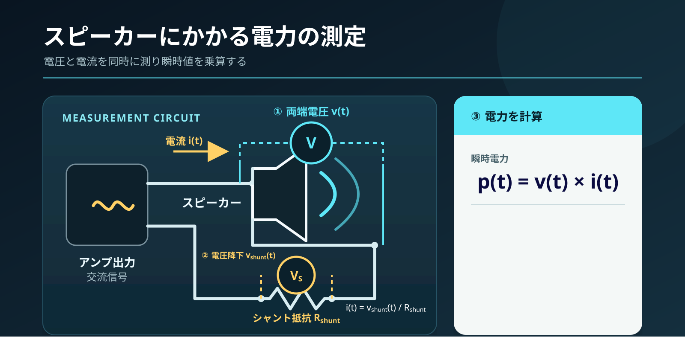

過渡的な変化を見るには、この電圧と電流を短い間隔で測定し、その積を記録すればよい。主な考慮点は次の通りである。

- 電流と電圧は「同時」に測定する。測定時刻がずれると、正確な瞬時電力を求められない。
- シャント抵抗には0.1Ωを使用する。
- D級アンプはBTL構成が多いので、左右チャネルでGNDを共通にできない。差動増幅で受ける必要がある。
- サンプリング周波数は40kHzとする。

## シャント抵抗

0.1Ωの抵抗にはセメント抵抗を使うことも多いが、今回は[金属板抵抗器](https://akizukidenshi.com/catalog/g/g110697/)を使用した。[事前の測定結果](https://www.ruimo.com/blog/speakerwatmeter2/)では、セメント抵抗よりも良好な高周波特性が得られている。


# 構成図

アナログ部では、オペアンプによる差動増幅回路を使ってスピーカーの電流と電圧を測定し、その出力をマイクロコントローラー[CH32V203](https://akizukidenshi.com/goodsaffix/CH32V203.pdf)のA/D変換器に入力する。CH32V203には2つのA/D変換器を同時に起動する機能があるため、電流と電圧を同じタイミングで測定できる。

CH32V203で取得したデータは[ESP32](https://akizukidenshi.com/goodsaffix/esp32-wroom-32e_esp32-wroom-32ue_datasheet_en.pdf)に集約し、WebSocketでPCへ送信する。ESP32はマイクロコントローラーとWi-Fi機能を内蔵しており、今回のような用途にぴったりである。

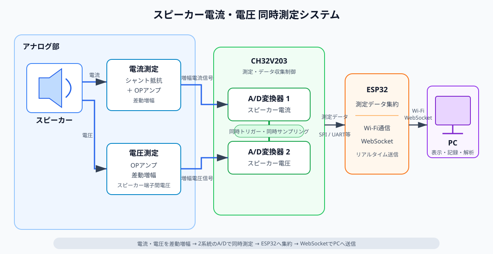

# 詳細設計

## アナログ部

回路図を以下に示す。{{ <r2_clickable_img src="analogSchematics.png" alt="" page={page} config={config} /> }}

アナログ部は、5V電源で動作するオペアンプを使って差動増幅回路を構成した。

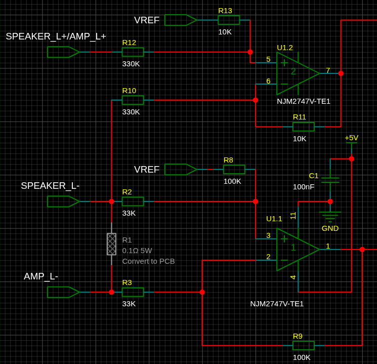

電圧測定部のゲインは1/33、電流測定部は100/33とした。CH32V203のA/D入力範囲は0〜3.3Vなので、そのままでは正負に振れるオーディオ信号を測定できない。そこで、3.3Vを半分に分圧して基準電圧`Vref`を作り、これを信号の0点とした。つまり、1.65Vを中心に0〜3.3Vの範囲でスイングさせる。

さらに、プログラマブルゲインアンプ（PGA）を入れ、ソフトウェアからゲインを変更できるようにした。

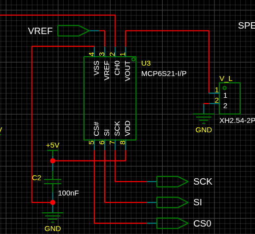

SPI経由でマイコンからゲインを変更できるため、今回のような測定器に使うと便利である。

- [アナログ部の詳細](https://github.com/ruimo/speakerWattMeter/tree/main/analog)

## デジタル部

回路図を以下に示す。{{ <r2_clickable_img src="digitalSchematics.png" alt="" page={page} config={config} /> }}

### A/D変換

A/D変換にはCH32V203を用いた。2つのA/D変換器を同時に起動でき、今回の目的に合っていたためである。A/D変換クロックは最大14MHzに対応しており、速度も十分である。

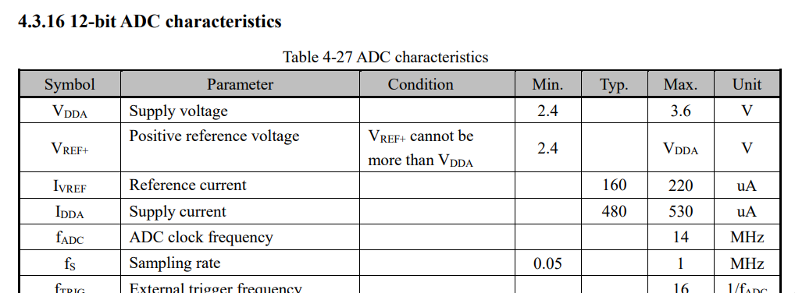

処理能力の面では少々オーバースペックだが、100円程度で購入できる（[2026年10月現在、AliExpressで10個1,000円ほど](https://ja.aliexpress.com/item/1005005304982586.html)）ので問題ない。欠点は、ピン間隔0.5mmの48ピンパッケージ（LQFP48）で、はんだ付けが面倒なことくらいである。

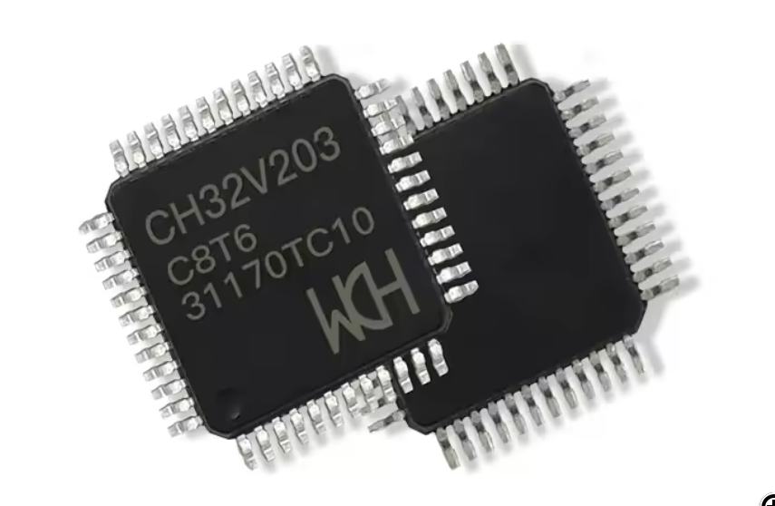

CH32V203のアナログ入力電圧の上限はVCC+0.3Vである。一方、アナログ部の電源は5Vなので、そのままでは過大入力時にCH32V203を破損するおそれがある。

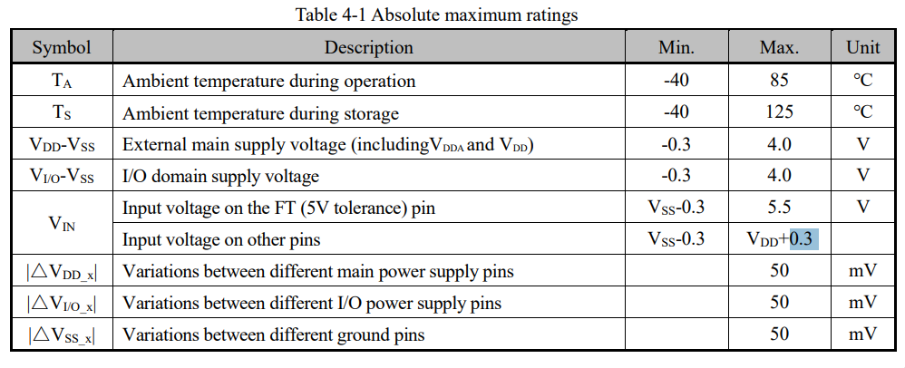

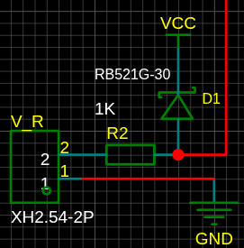

そこで、ショットキーバリアダイオード[RB521G-30](https://akizukidenshi.com/catalog/g/g113956/)で入力電圧をクランプしている。

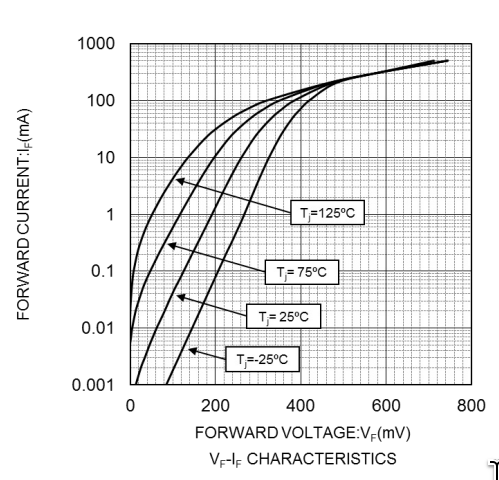

このダイオードは順方向電圧が非常に小さく優秀なのだが、パッケージがSOD-723（1mm × 0.6mm）で、はんだ付けがなかなか難しい。

1秒間に40,000回のA/D変換を起動するため、当初はタイマー割り込みを使っていた。しかし、この方法では左右チャネルの測定タイミングがずれてしまう。多少のずれなら大きな問題にはならないが、できれば揃えたい。そこで、PWMで40kHzの矩形波を生成してPB0から出力し、両方のCH32V203のPA11へ入力することで、A/D変換を直接起動するようにした。割り込みではなく、ハードウェアの機能を利用している。

A/D変換結果の転送にはDMAを使い、出力先を循環バッファとした。つまり、A/D変換結果の取り込みはすべてハードウェアで実行され、CPUが介在しなくても着々と進む。もちろん、循環バッファが一周すると過去のデータは上書きされるため、その前にデータを取り出さなければならない。

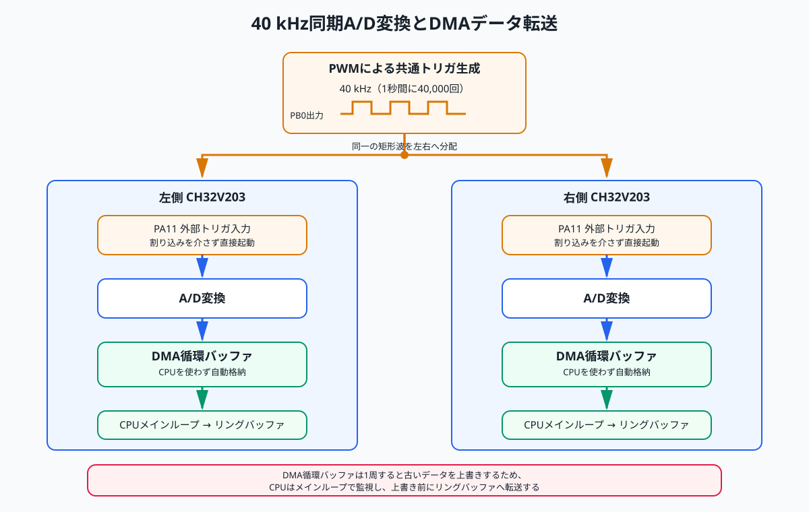

### CH32V203からESP32への転送

CH32V203は左右チャネルに1個ずつあり、そこからESP32へA/D変換結果を転送する必要がある。A/D変換結果は1つにつき12bitで、電流と電圧を合わせると1チャネルあたり24bit、左右で48bitとなる。これを1秒間に40,000回送るため、必要な転送速度は約2Mbpsになる。

$$
bps = 24 \cdot 2 \cdot 40000 = 1920000 = 1.92Mbps
$$

この速度になると、通信方式はSPIが適している。ESP32をマスター、CH32V203をスレーブとし、左右のA/D変換結果を交互に収集する。

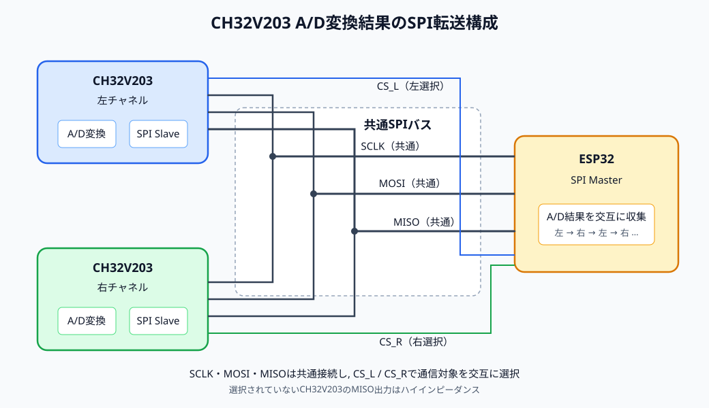

今回の転送速度では、データが失われても検出が難しい。そこで、転送データにシーケンス番号を入れることにした。

```text
 bit: 31        24 23        12 11         0
     +------------+------------+------------+
     |  seq (8)   | adc2 (12)  | adc1 (12)  |
     +------------+------------+------------+
```

1サンプルが32bitに収まり、都合がよい。シーケンス番号は8bitなので、ちょうど256パケット失われた場合は検出できないが、そのような事象が繰り返し発生することは考えにくい。当初は、SPIのCSがアサートされた時点で割り込みを発生させ、SCLKが始まるまでに送信データを準備する設計にしていた。

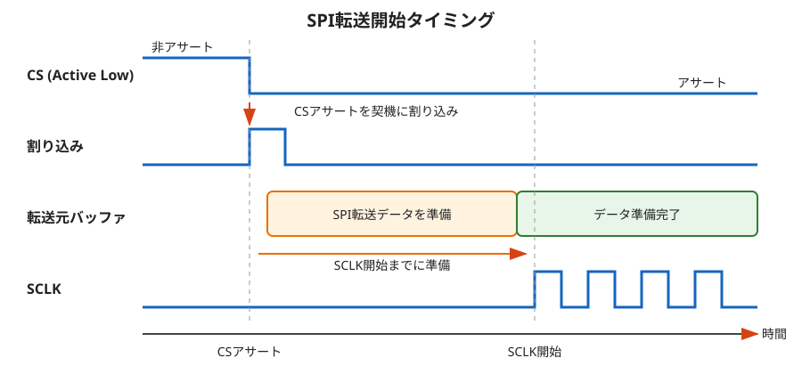

しかし、これは典型的な競合状態（race condition）である。SCLKの開始が早ければ、データの準備が間に合わないままSPI転送が始まってしまう。タイミング次第で間に合うこともあれば、間に合わないこともあり、その結果、時折データが破損することになる。このような設計は避けるべきである。

そこで、SPIの送信データをインターリーブして準備することにした。SPI転送が終わってCSがデアサートされた時点で割り込みを発生させ、次回の送信データを準備する。転送にはDMAを使うため、次にSCLKが入力されると、CPUの介在なしに転送が始まる。左右を交互に転送するので、反対側のチャネルを転送している間に、自分の次の送信データを準備できればよい。

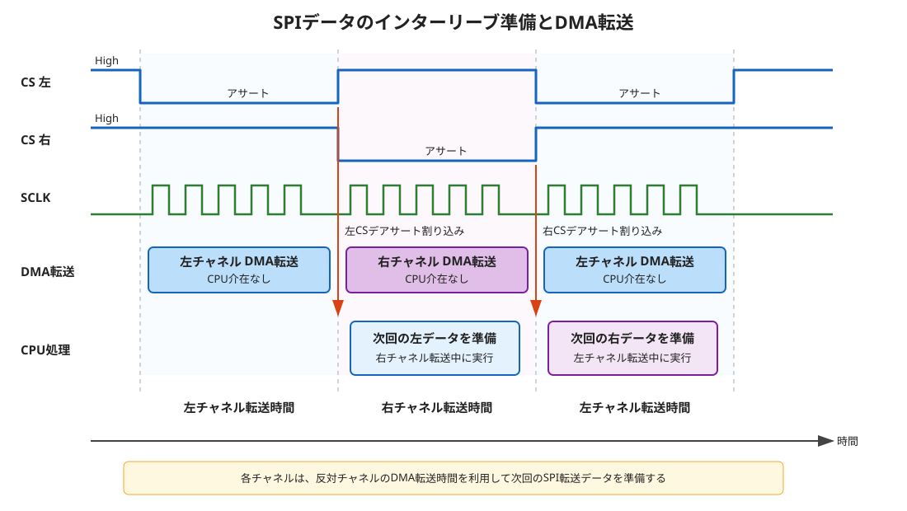

- [CH32V203部の詳細](https://github.com/ruimo/speakerWattMeter/tree/main/controller)

### UI

UIは[egui](https://github.com/emilk/egui)を使い、Rustで実装した。完成版はブラウザー上でWebAssemblyとして動作し、ESP32とはWebSocketで通信する。WebAssemblyのプログラムはESP32に格納されており、ESP32へブラウザーでアクセスするとダウンロードされ、そのままブラウザー上で実行される。

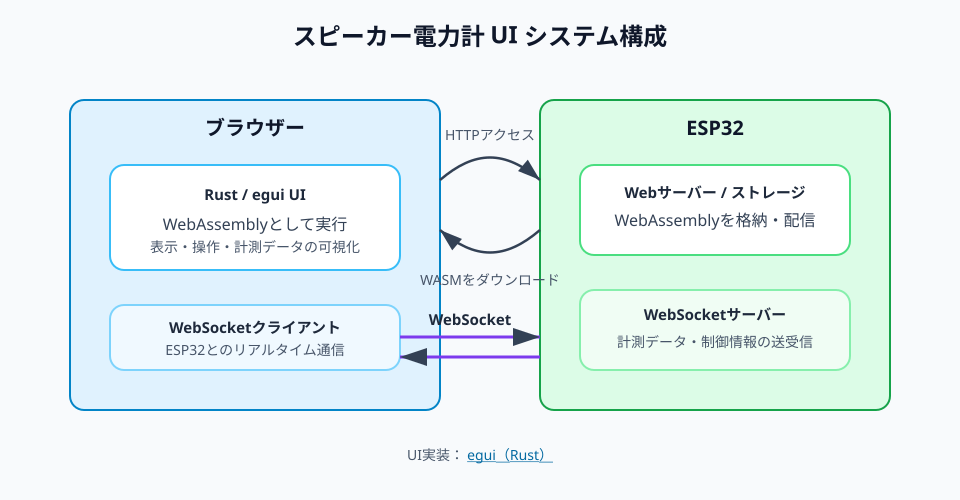

完成版はこれでよいが、開発中にWebAssemblyを毎回ESP32へ書き込むのは効率が悪い。そこで、同じUIをローカルアプリケーションとしても動かせるようにした。eguiを利用しているため、ビルド方法を変更するだけで対応できる。この場合はWebAssemblyを使わず、ローカルアプリケーションとESP32がWebSocketで通信する。

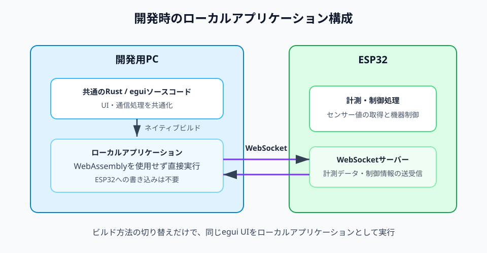

UIには、電流、電圧、瞬時電力の各波形を表示し、測定中の最大瞬時電力を記録する機能を設けた。また、次の測定を行うキャリブレーション機能も用意した。

- 無入力時のA/D変換結果の収集
- 8Ωのダミーロードを接続し、既知の入力（例：4V、0.5A）を加えたときのA/D変換結果の収集

得られたキャリブレーション結果は、ESP32のフラッシュメモリーに保存する。

WebAssemblyをESP32に格納するため、ある程度のフラッシュ容量が必要になる。8MBあれば十分なようだが、価格も大して変わらないため、今回はESP32-N16R8を使用した。[2026年10月現在、AliExpressで500円ほどで入手できる](https://ja.aliexpress.com/item/1005009314619102.html)。

- [UIの詳細](https://github.com/ruimo/speakerWattMeter/tree/main/ui)

### 共通プロトコル

CH32V203とESP32のプログラムは、どちらもRustで実装した。そのため、両者の間で使う通信プロトコルの定義を共通のRustコードとして記述できる。この点はRustを使う利点の一つである。

- [共通プロトコルの詳細](https://github.com/ruimo/speakerWattMeter/tree/main/proto)

## 電源

当初は5VのACアダプターを使っていたが、ACアダプター由来のノイズがかなり大きかった。そこで、[村田製作所のEMIフィルター](https://akizukidenshi.com/catalog/g/g105287/)を入れた電源回路を追加した。

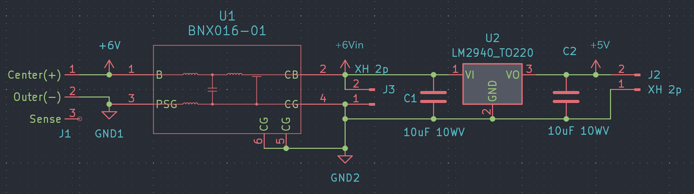

## 基板

基板はJLCPCBで製造した。現在はJLCPCBアプリのキャンペーン中らしく、今回の基板は送料を含めても3ドル以下で発注できた。いつもながら、この低価格ぶりには恐れ入る。

アナログ部

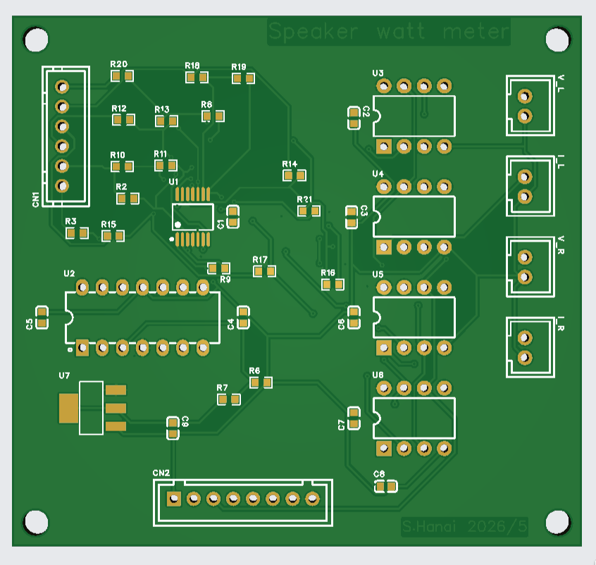

デジタル部

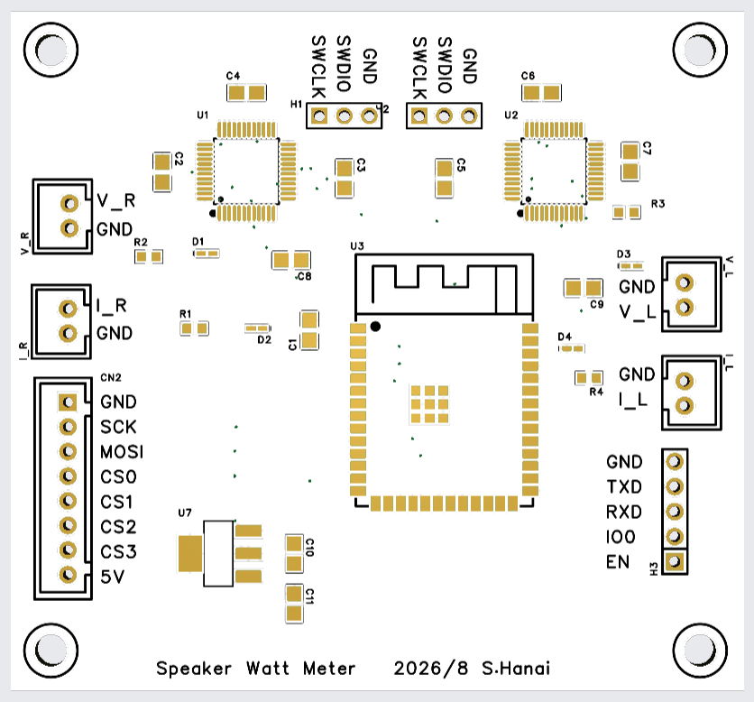

電源部

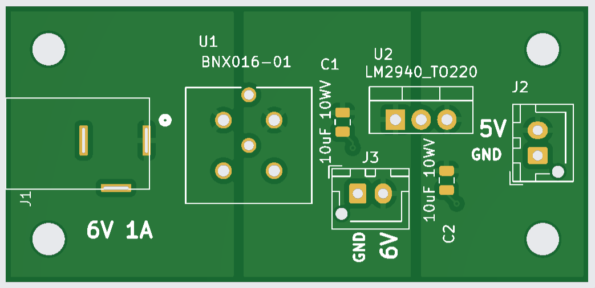

## ケース

{{ <obj_viewer src="all-case.obj" title="ケース（マウスでドラッグ可能）" page={page} config={config} /> }}

基板は3Dモデルをエクスポートし、その他の主要部品は3Dスキャナーでスキャンした。これらを基に[FreeCAD](https://www.freecad.org/index.php)でケースを設計した。製造は[メルカリの3Dプリント代行](https://jp.mercari.com/search?keyword=3d%E3%83%97%E3%83%AA%E3%83%B3%E3%83%88%E4%BB%A3%E8%A1%8C)へ依頼し、PETGで印刷してもらった。送料を含めて1,600円だった。3Dプリントなら穴の位置がぴたりと決まるので気持ちがよい。

# 測定結果

最後に測定結果をお見せしたい。

### アンプ

[AIYIMA A07](https://ja.aliexpress.com/item/1005008529243001.html)を使用した。私が購入したときはセール中で、8,000円を切っていた。欲を言えば、もう少し電源スイッチの質感がよいとうれしいが、この価格でそれを望むのは酷であろう。

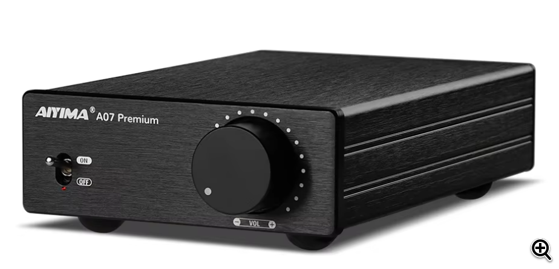

公称出力は300W × 2。電源には48V、10AのACアダプターを使用した。こちらも約8,000円だった。

### スピーカー

[B&W 702 S3 Signature](https://www.bowerswilkins.com/ja-jp/product/loudspeakers/702-s3-signature/FP43540P.html)を使用した。感度は90dB（軸上1m、2.83V入力）。

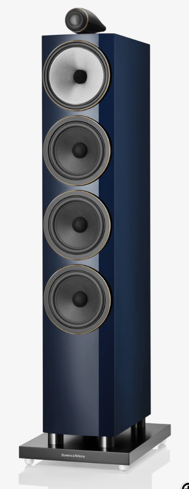

### スピーカーケーブル

スピーカーケーブルには[カナレの4S11](https://www.canare.co.jp/products/cables/index.php?tid=4_008)を使用した。久しぶりにヤフオクを利用し、10mを5,000円ほどで購入した。むやみに高価なケーブルを選ぶよりも、こちらをお勧めしたい。


測定には、ブルックナーの交響曲第3番第1楽章を使用した。

{{ <r2_clickable_img src="watt.png" alt="測定結果の画面" page={page} config={config} /> }}

画面左上には、測定中の最大瞬時電力が表示されている。第1楽章の終了時点で、左チャネルに63.42Wが記録されていることが分かる。

# 結論

感度90dBのスピーカーを使い、一般家庭の一室で、音楽再生中にスピーカーへ供給される瞬時電力を測定した。その結果、今回の再生音量と測定条件では、瞬間的に60Wを超える電力が記録された。少なくとも「家庭では10Wもあれば常に十分」とは言い切れないようだ。

スピーカーの感度が1dB下がると、同じ音圧を得るために必要な電力は約1.26倍になる。感度90dBで60Wを基準とすると、感度$n$ dBのスピーカーに必要な電力$W$の概算は次のようになる。

$$
W = 60\text{ W} \cdot 10^{\frac{(90 - n)}{10}}
$$

感度80〜95dBについて計算した結果を以下に示す。

| 感度 n (dB) | 必要電力の概算 (W) |
|---:|---:|
| 80 | 600.0 |
| 81 | 476.6 |
| 82 | 378.6 |
| 83 | 300.7 |
| 84 | 238.9 |
| 85 | 189.7 |
| 86 | 150.7 |
| 87 | 119.7 |
| 88 | 95.1 |
| 89 | 75.5 |
| 90 | 60.0 |
| 91 | 47.7 |
| 92 | 37.9 |
| 93 | 30.1 |
| 94 | 23.9 |
| 95 | 19.0 |

この表は、今回と同じ音量、聴取位置、部屋、楽曲という条件を仮定し、感度の差だけから換算した値である。実際に必要な出力は、部屋の広さや反射、聴取距離、再生音量、楽曲のダイナミックレンジ、スピーカーのインピーダンス特性などによって変わるため、参考値として見てほしい。また、アンプを選ぶ際には、定格出力だけでなく、負荷インピーダンスやクリッピング時の挙動も考慮する必要がある。

価格.comを見ると、ブックシェルフ型には感度80dB前後の製品も少なからずある。こうしたスピーカーを大きな音量で鳴らし、音楽のピークを余裕を持って再生するには、相応のアンプ出力が必要になる。つまり、数百W出力のアンプにも、きちんと存在理由があったのだ。

これで長年の疑問がようやく解けた。
